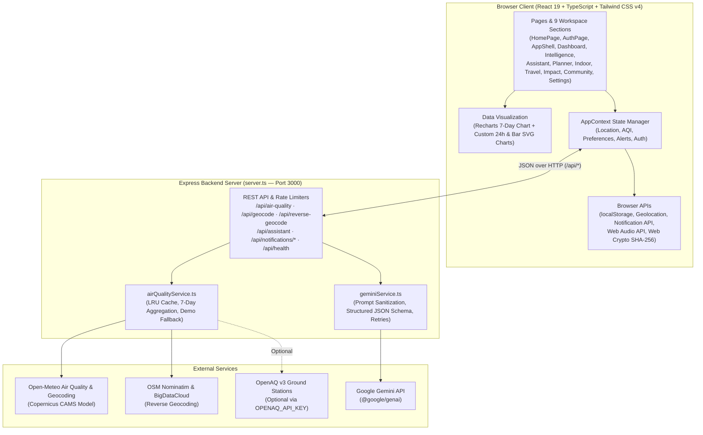

<div align="center">


# VayuMitra (वायुमित्र)

### AI-Powered Urban Air Quality Assistant

**Breathe Smarter. Live Cleaner. Stay Safer.**

[](https://react.dev/)
[](https://www.typescriptlang.org/)
[](https://vite.dev/)
[](https://expressjs.com/)
[](https://tailwindcss.com/)
[](#11-testing)

*An intelligent, privacy-first web application that turns local atmospheric data into practical daily routines, exposure guidance, low-emission travel comparisons, and timely air quality alerts for individuals and families.*

</div>

---

## Table of Contents

- [1. Overview](#1-overview)
- [2. Key Features & Implementation Status](#2-key-features--implementation-status)
- [3. Screenshots & Preview](#3-screenshots--preview)
- [4. Technology Stack](#4-technology-stack)
- [5. Application Architecture](#5-application-architecture)
- [6. How It Works](#6-how-it-works)
- [7. Installation & Setup](#7-installation--setup)
- [8. Environment Variables](#8-environment-variables)
- [9. API Integrations & Data Accuracy](#9-api-integrations--data-accuracy)
- [10. Security & Privacy](#10-security--privacy)
- [11. Testing](#11-testing)
- [12. Future Improvements](#12-future-improvements)
- [13. Contributing](#13-contributing)
- [14. License](#14-license)
- [15. Acknowledgements](#15-acknowledgements)

---

## 1. Overview

Urban air pollution—especially seasonal winter smog, fine particulate matter ($\text{PM}_{2.5}$), coarse dust ($\text{PM}_{10}$), and traffic-corridor nitrogen dioxide ($\text{NO}_2$)—poses a daily health challenge across major Indian metros and growing cities worldwide. Yet raw AQI numbers rarely tell families *what to actually do*: when to ventilate rooms, whether an evening run is sensible, which commute choice lowers emissions, or how to protect children and older adults.

**VayuMitra (वायुमित्र)** bridges the gap between atmospheric pollutant forecasts and everyday decisions:

- **Clear Local Context:** Translates US EPA AQI, European EEA AQI, and 5 core pollutants ($\text{PM}_{2.5}$, $\text{PM}_{10}$, $\text{NO}_2$, $\text{O}_3$, $\text{SO}_2$) into plain-language guidance with 24-hour forecasts and 7-day historical trends.
- **Context-Aware AI Guidance:** Combines live local air-quality readings with a user's optional household profile (commute mode, schedule, sensitive age groups) to generate structured, non-alarmist recommendations—with a transparent rule-based fallback if the AI service is unavailable.
- **Practical Daily Action:** Pairs exposure protection (Smart Daily Planner, Indoor Air Guide, Personal Exposure Score, Smart Air Alerts) with sustainability habits (Green Travel Planner, Environmental Impact Calculator, Weekly Clean Air Challenge).
- **Target Users:** Urban commuters, parents with school-aged children, seniors, respiratory-sensitive individuals, and sustainability-conscious households.

---

## 2. Key Features & Implementation Status

VayuMitra clearly distinguishes what is fully built today, what operates locally in the browser, and what requires additional backend infrastructure.

### Feature Summary Matrix

| Feature | Status | Details |
| :--- | :--- | :--- |
| **Air Quality Dashboard (Current + 24h + 7-Day Recharts Trend)** | Fully Implemented | US EPA AQI (0–500) & European EEA AQI, 6-tier accessible color/icon visuals, pollutant cards ($\text{PM}_{2.5}$, $\text{PM}_{10}$, $\text{NO}_2$, $\text{O}_3$, $\text{SO}_2$), interactive 24-hour SVG curve, and 7-day historical Recharts trend with daily peak overlay & health guideline lines. |
| **GPS Detection, Reverse Geocoding & Location Search** | Fully Implemented | Indian metro presets (Delhi, Mumbai, Bengaluru, Pune), worldwide city search (Open-Meteo + Nominatim fallback), browser GPS with reverse geocoding to City/Area/State/Country, and manual Lat/Lon entry. |
| **AI Air Assistant** | Fully Implemented | Server-side Google Gemini API integration returning 6 structured sections (*Situation, Recommendation, Explanation, Expected Benefit, Estimated Impact, Limitations & Uncertainty*), plus automatic rule-based fallback. |
| **Smart Daily Routine Planner** | Fully Implemented | Generates time-slotted morning, exercise, commute, ventilation, and evening routines grounded in hourly $\text{PM}_{2.5}$ forecasts; supports custom tasks, completion tracking, and local persistence. |
| **Indoor Air Quality Guide & Checklist** | Fully Implemented | Room-by-room science-backed guidance (Bedroom, Kitchen, Living Room, Workspace, Community) covering HEPA filtration, cooking exhaust, dust control, and combustion sources, with persistent checklists. |
| **Green Travel Planner (Standard + Custom Mode)** | Fully Implemented | Compares Walking, Cycling, Public Transit, Carpool, and Private Car emissions using documented UK DESNZ/DEFRA (2024) & India GHG Program factors, plus a **Custom** mode supporting 8 vehicle types, passenger counts, and transparent formulas. |
| **Environmental Impact Calculator** | Fully Implemented | Tracks weekly/annual $\text{CO}_2\text{e}$ avoided, vehicle km shifted, no-idling habits, and historical weekly progress logs with visual comparison charts. |
| **Advanced Air Intelligence** | Fully Implemented | Includes a **Personal Exposure Score** (0–100 based on outdoor hours, exertion, mask type, and indoor protection), **Threshold Alerts** (live + simulated preview), **Outdoor Activity Advisor**, **Indoor Topic Assistant**, and a **7-Action Weekly Clean Air Challenge**. |
| **VayuMitra Smart Air Alerts (Page-Active)** | Fully Implemented | Browser Notification API alerts with explicit user opt-in, permission states (*Enabled, Disabled, Blocked, Unsupported*), configurable thresholds, cooldown & duplicate suppression, worsening escalation, improvement updates, test button, and history log. |
| **Settings, Theme & Optional Wind Ambience** | Fully Implemented | Light/Dark theme persistence, household personalization, data export/reset controls, original animated SVG logo (`prefers-reduced-motion` aware), and opt-in procedural Web Audio wind ambience (no autoplay, mute, volume, route-aware auto-stop). |
| **Community Pollution Observations** | Partially Implemented (Local-Only) | Full reporting form, category/city filters, status toggles, and PII-blocking validation, stored in browser `localStorage` with clearly labelled sample observations (no shared multi-user backend database yet). |
| **User Accounts & Guest Mode** | Partially Implemented (Local Demo Auth) | Sign-up, sign-in, and Guest access using salted Web Crypto SHA-256 password hashing stored strictly in browser `localStorage`. Not a server-backed multi-device account system. |
| **Nearby Ground Sensor Readings (OpenAQ v3)** | Optional (Env-Gated) | Backend & Dashboard UI are implemented and activate automatically when `OPENAQ_API_KEY` is configured. |
| **Background Web Push (Closed Tab / Mobile Push)** | Planned / Not Configured | Subscription validation endpoint exists (`POST /api/notifications/subscribe`), but background delivery requires VAPID keys, a persistent subscription store, and a background worker. Honestly reported as `NOT_CONFIGURED` in Settings. |

---

## 3. Screenshots & Preview

> **Note:** No static UI screenshot images are currently committed in this repository (`src/assets/images/` contains in-app editorial imagery only). Capture screenshots of your running build and place them in `docs/screenshots/` using the layout below to populate this showcase.

| View | Planned Screenshot Path | Highlights to Capture |
| :--- | :--- | :--- |
| **Homepage** | `docs/screenshots/homepage.png` | Original VayuMitra (वायुमित्र) animated logo, hero preview, and clean navigation |
| **Air Quality Dashboard** | `docs/screenshots/dashboard.png` | 6-tier AQI card, GPS/city selector, 24-hour curve, and 7-day Recharts historical trend |
| **AI Air Assistant** | `docs/screenshots/ai-assistant.png` | Contextual prompt chips and 6-section structured Gemini response card |
| **Green Travel Planner** | `docs/screenshots/green-travel.png` | Custom vehicle/passenger $\text{CO}_2\text{e}$ calculator, formula breakdown, and comparison chart |
| **Advanced Air Intelligence** | `docs/screenshots/advanced-intelligence.png` | Personal Exposure Score, Outdoor Activity Advisor, and Weekly Clean Air Challenge |
| **Smart Air Alerts (Settings)** | `docs/screenshots/notification-settings.png` | Permission controls, threshold sliders, cooldown settings, and alert history |

---

## 4. Technology Stack

Every technology listed below is verified directly against `package.json`, `server.ts`, `server/`, and `src/`:

| Layer | Technologies Used |
| :--- | :--- |
| **Frontend Framework** | React 19 (`react`, `react-dom`), TypeScript 7, Vite 8 |
| **Styling & Design System** | Tailwind CSS v4 (`@tailwindcss/vite`), custom CSS keyframe animations with `prefers-reduced-motion` support, Light/Dark class theming |
| **Data Visualization** | Recharts (`^3.11.1`) for the 7-day historical air quality chart; custom accessible interactive SVG charts (`HourlyTrendChart`, `BarComparisonChart`); Lucide React icons |
| **Audio Experience** | Native browser **Web Audio API** (`src/utils/soundEngine.ts`) synthesizing original procedural pink/brown noise wind ambience with zero external audio files |
| **Backend Server** | Node.js + Express (`server.ts`, executed via `tsx` in dev and Node in production) serving REST `/api/*` proxies, rate limiting, in-memory LRU caching, and Vite middleware / static `dist/` |
| **AI Integration** | Google Gemini API via `@google/genai` SDK (`server/geminiService.ts`) with strict JSON `responseSchema`, prompt-injection boundary tags, and rule-based fallback |
| **Air Quality & Geocoding** | Open-Meteo Air Quality API (Copernicus CAMS), Open-Meteo Geocoding API, OpenStreetMap Nominatim (search fallback & primary reverse geocoding), BigDataCloud (secondary reverse geocoding), optional OpenAQ v3 ground stations |
| **Storage & Persistence** | Browser `localStorage` (`src/utils/storage.ts`) — no external database required |
| **Authentication** | Browser-local Demo Authentication (`src/utils/auth.ts`) with per-account 16-byte random salt + Web Crypto SHA-256 hashing, plus Guest access |
| **Notifications** | Browser Notification API (`src/utils/notifications.ts`) for page-active alerts; `server/pushValidation.ts` for future Web Push SSRF-safe validation |
| **Testing** | Node.js built-in test runner (`node:test`) + `tsx` + `react-dom/server` SSR smoke testing (`tests/vayumitra.test.ts`) |

---

## 5. Application Architecture

VayuMitra uses a unified Node.js + Express server (`server.ts`) that proxies all external API calls (protecting secrets and adding rate limiting + caching) while serving the React + TypeScript single-page application.



### Repository Structure

```text
.
├── index.html                           # HTML entry point & favicon
├── server.ts                            # Express server, API routes, rate limiters & Vite/dist hosting
├── server/
│   ├── airQualityService.ts             # Open-Meteo AQI (24h + 7-day), OpenAQ v3, geocoding & demo fallback
│   ├── geminiService.ts                 # Server-side Gemini AI structured assistant & input sanitization
│   └── pushValidation.ts                # SSRF-safe Web Push subscription payload validator
├── public/
│   └── vayumitra-alert-icon.svg         # Original vector brand mark & browser notification icon
├── src/
│   ├── App.tsx                          # View routing (HomePage, AuthPage, AppShell)
│   ├── context/AppContext.tsx           # Global state, AQI fetching, polling & alert evaluation
│   ├── services/api.ts                  # Frontend API client with request deduplication & timeouts
│   ├── types/index.ts                   # Shared TypeScript interfaces
│   ├── data/indoorGuideData.ts          # Evidence-based indoor air guide rooms & checklist items
│   ├── utils/
│   │   ├── aqi.ts                       # 6-tier US EPA AQI categories, 7-day aggregation & rule fallback
│   │   ├── advancedIntelligence.ts      # Exposure score, alerts, activity advisor & weekly challenge
│   │   ├── auth.ts                      # Browser-local salted SHA-256 demo authentication
│   │   ├── calculations.ts              # Emission factors, Custom Travel, Impact & Daily Planner logic
│   │   ├── notifications.ts             # Smart Air Alerts deduplication, cooldown & escalation engine
│   │   ├── soundEngine.ts               # Procedural Web Audio API wind ambience synthesizer
│   │   ├── storage.ts                   # localStorage keys, presets & safe JSON persistence
│   │   └── validation.ts                # Input validation & PII-blocking sanitizers
│   └── components/
│       ├── brand/VayuMitraLogo.tsx      # Original animated SVG logo component
│       ├── charts/                      # WeeklyHistoryChart (Recharts), HourlyTrendChart, BarComparisonChart
│       ├── layout/AppShell.tsx          # Responsive desktop sidebar & mobile drawer navigation
│       ├── pages/                       # HomePage, AuthPage
│       ├── sections/                    # All 9 workspace feature sections
│       ├── settings/SmartAirAlertsCard.tsx
│       └── ui/                          # AmbientSoundControl, AqiStatusIcon, MoreInfo
└── tests/
    └── vayumitra.test.ts                # 15 automated unit, security, notification & SSR smoke tests
```

---

## 6. How It Works

1. **Location Selection or GPS Detection:** Users start on a default Indian metro preset (Delhi, Mumbai, Bengaluru, or Pune), search any city worldwide, enter manual coordinates, or click **Use My Location**. GPS coordinates are reverse-geocoded via OpenStreetMap Nominatim (with BigDataCloud fallback) to display a readable place name (e.g., *Lonavala, Maharashtra, India*). If reverse geocoding fails, exact coordinates are shown without fabricating a place name.
2. **Air Quality Retrieval & Caching:** The client calls `GET /api/air-quality`. The Express backend checks its 10-minute in-memory LRU cache and queries Open-Meteo (`past_days=6&forecast_days=2`)—plus OpenAQ v3 if configured. If Open-Meteo is unreachable and no cache exists, a clearly labelled `DEMO` fallback dataset is returned.
3. **Processing & Visualization:** The server slices the upcoming 24-hour forecast and aggregates the past 7 local calendar days (`dailyHistory` avg/min/max). The Dashboard renders the 6-tier US EPA AQI card, European EEA AQI, pollutant breakdown, 24-hour curve, and 7-day Recharts historical chart.
4. **Contextual AI Recommendations:** When the user asks a question in **AI Air Assistant**, the app sends the question alongside current location readings and optional household preferences to `POST /api/assistant`. Gemini returns a validated 6-field JSON response; if the API key is missing, rate-limited, or unavailable, the app automatically falls back to context-aware rule-based guidance with a transparent notice.
5. **Routines & Sustainability Actions:** Users generate personalized daily schedules, follow room-by-room indoor air checklists, compute custom trip $\text{CO}_2\text{e}$ footprints, estimate personal particulate exposure, and log weekly low-emission progress—all saved privately in browser `localStorage`.
6. **Smart Air Alerts:** When explicitly enabled in **Settings**, VayuMitra polls fresh forecast data at a configurable interval while the tab is open and visible, triggering Browser Notification API alerts when readings cross user-configured thresholds (with cooldown, duplicate prevention, worsening escalation, and improvement updates).

---

## 7. Installation & Setup

### Prerequisites

- **Node.js** v20+ (recommended for built-in `fetch`, Web Crypto, and `node:test`)
- **npm** (included with Node.js)

### Step-by-Step Setup

1. **Clone the repository**

   ```bash
   git clone <your-repository-url>
   cd <your-project-directory>
   ```

2. **Install dependencies**

   ```bash
   npm install
   ```

3. **Configure environment variables**

   Copy `.env.example` to `.env` and add your keys (see [Environment Variables](#8-environment-variables)):

   ```bash
   cp .env.example .env
   ```

4. **Start the development server**

   ```bash
   npm run dev
   ```

   This starts `tsx server.ts` on `http://localhost:3000` with Express API routes and Vite middleware attached to the same HTTP/WebSocket port.

5. **Run TypeScript checks and automated tests**

   ```bash
   npm run lint
   npm test
   ```

6. **Build and run for production**

   ```bash
   npm run build
   NODE_ENV=production npm start
   ```

### Available npm Scripts

| Command | Description |
| :--- | :--- |
| `npm run dev` | Starts the Express + Vite development server on port `3000` (`tsx server.ts`) |
| `npm run build` | Compiles the React/TypeScript frontend bundle into `dist/` (`vite build`) |
| `npm start` | Runs the production Express server (`node server.ts`; set `NODE_ENV=production` to serve `dist/`) |
| `npm run lint` | Runs strict TypeScript type-checking (`tsc --noEmit`) |
| `npm test` | Executes the 15-test automated suite (`tsx --test tests/vayumitra.test.ts`) |
| `npm run clean` | Removes `dist/` and temporary build artifacts |

---

## 8. Environment Variables

An example template is already provided in [`.env.example`](.env.example). Keep all secrets strictly in `.env` (never commit `.env` or prefix server secrets with `VITE_`).

```env
GEMINI_API_KEY="MY_GEMINI_API_KEY"
OPENAQ_API_KEY=""
APP_URL="http://localhost:3000"
VAPID_PUBLIC_KEY=""
VAPID_PRIVATE_KEY=""
VAPID_SUBJECT=""
```

| Variable | Required? | Purpose |
| :--- | :--- | :--- |
| `GEMINI_API_KEY` | Optional (Recommended) | Enables server-side Gemini AI responses on `POST /api/assistant`. If omitted, the AI Assistant automatically uses honest rule-based guidance. |
| `OPENAQ_API_KEY` | Optional | Enables nearby physical ground monitoring station readings ($\text{PM}_{2.5}$, $\text{PM}_{10}$, $\text{NO}_2$) via OpenAQ v3 within 15 km of the selected coordinates. |
| `APP_URL` | Optional | Public URL where the application is hosted (used for self-referential environment configuration). |
| `PORT` | Optional | Server port override (defaults to `3000`). |
| `DISABLE_HMR` | Optional | Set to `true` to disable Vite file watching and HMR in restricted preview environments. |
| `VAPID_PUBLIC_KEY`, `VAPID_PRIVATE_KEY`, `VAPID_SUBJECT` | Optional (Not Active) | Reserved for future background Web Push configuration; background push delivery still requires a persistent subscription store and scheduler worker. |

---

## 9. API Integrations & Data Accuracy

VayuMitra is engineered to be transparent about what its numbers represent and what they do not.

### External Data Sources

- **Open-Meteo Air Quality API (Copernicus CAMS):** Primary data provider for current readings, 24-hour forecasts, and 7-day historical daily archives (`past_days=6&forecast_days=2`). Uses atmospheric chemistry grid models (~45 km global / ~11 km Europe resolution).
- **OpenAQ v3 API (Optional):** Provides nearest physical ground-station measurements within 15 km when `OPENAQ_API_KEY` is configured, clearly separated from model forecasts in its own Dashboard card.
- **Open-Meteo Geocoding & OpenStreetMap Nominatim / BigDataCloud:** Used for manual city search and GPS reverse geocoding.

### Data Provenance & Transparency

| Data State | Meaning in VayuMitra |
| :--- | :--- |
| `MODEL FORECAST (LIVE)` | Fresh Open-Meteo Copernicus CAMS atmospheric model forecast (not an official Indian CPCB ground-station certificate). |
| `CACHED FORECAST` / `CACHED · STALE` | Served from the Express server's in-memory LRU cache (10-minute TTL; flagged stale after 30 minutes). |
| `DEMO FALLBACK (NOT LIVE)` | Illustrative diurnal & 7-day profile displayed only when Open-Meteo is unreachable and no cache exists. Clearly flagged with a warning banner and excluded from automated Smart Air Alerts. |

### Key Limitations to Keep in Mind

- **AQI Standards:** The Dashboard displays **US EPA AQI (0–500)** and **European EEA AQI**. Their category breakpoints differ from India's official **CPCB National AQI (NAQI)**.
- **Grid Model vs. Street Sensors:** Modelled forecasts (~45 km grid) smooth out hyper-local hotspots such as roadside diesel corridors, construction sites, or localized biomass burning.
- **Location Accuracy:** Browser GPS precision varies by device and indoor signal strength. If reverse geocoding fails, VayuMitra displays raw coordinates instead of guessing a nearby town.
- **Notification Scope:** Smart Air Alerts use the browser's native **Notification API** and operate **while VayuMitra is open** (page-active monitoring). They never trigger on `DEMO`, `CACHED`, or stale (`>30 min`) data. Background push notifications when the tab/browser is closed are **not configured** and require a persistent subscription database and background worker.
- **Non-Medical Disclaimer:** All recommendations and exposure scores are informational environmental guidance, not medical diagnoses or clinical advice.

---

## 10. Security & Privacy

The following safeguards are actively implemented in the codebase:

- **Server-Side API Key Protection:** `GEMINI_API_KEY` and `OPENAQ_API_KEY` are read exclusively in Express backend services (`server/geminiService.ts`, `server/airQualityService.ts`) and are never exposed to client bundles or browser `localStorage`.
- **HTTP Security Headers & Payload Limits:** `server.ts` disables `X-Powered-By`, sets `X-Content-Type-Options: nosniff`, `Referrer-Policy: strict-origin-when-cross-origin`, and `Permissions-Policy: camera=(), microphone=()`, and caps JSON bodies at `64kb`.
- **Rate Limiting:** Bounded sliding-window IP rate limiters protect `/api/assistant` (20 req/min), `/api/geocode` & `/api/reverse-geocode` (40 req/min), forced live refreshes (15 req/min), and `/api/notifications/subscribe` (15 req/min).
- **Prompt Injection Defense & Input Validation:** `server/geminiService.ts` strips control characters and `<system>`, `<context_data>`, and `<user_question>` breakout tags, wrapping untrusted questions in explicit delimiter tags. Client and server validate coordinate bounds, distance ranges, question lengths, and push subscription URLs (blocking non-HTTPS and private/loopback SSRF hosts in `server/pushValidation.ts`).
- **Privacy-First Local Storage & PII Blocking:** User preferences, schedules, and community observations stay in browser `localStorage` and can be cleared in one click from **Settings**. `validateCommunityReport` rejects phone numbers, email addresses, and exact flat/house addresses to protect reporter privacy.
- **Explicit Permissions:** Browser Geolocation (`navigator.geolocation`) and Browser Notifications (`Notification.requestPermission()`) are requested **only** after explicit user button clicks, with graceful handling for denied, blocked, timed-out, or unsupported states.
- **Local Demo Auth Hashing:** `src/utils/auth.ts` generates a 16-byte random salt per account and hashes passwords with Web Crypto `SHA-256`—never storing plaintext passwords. Because accounts reside in browser `localStorage`, the UI clearly labels this as *Local Demo Authentication*.

---

## 11. Testing

Automated tests live in [`tests/vayumitra.test.ts`](tests/vayumitra.test.ts) and run using Node's native test runner via `tsx`.

```bash
npm run lint   # TypeScript type check (tsc --noEmit)
npm test       # Automated unit, security & SSR smoke test suite
npm run build  # Production Vite bundle verification
```

### Verified Test Coverage (15/15 Passing)

The latest executed run passed **15 of 15** test cases alongside `tsc --noEmit` (0 errors) and `vite build`:

1. **Input Validation:** Coordinates, travel distances, `HH:MM` time strings, and AI assistant questions.
2. **Security & Privacy Sanitizers:** Plain-text stripping, PII blocking in community reports, and prompt-tag breakout stripping.
3. **Green Travel Calculations:** Standard commute modes and Custom vehicle/passenger $\text{CO}_2\text{e}$ formulas.
4. **Environmental Impact Calculator:** Baseline vs. improved $\text{CO}_2\text{e}$ savings and zero-baseline clamping.
5. **AQI Utilities & Daily Planner:** 6-tier US EPA categories, wall-clock local timestamps, demo fallback, and smart daily plan generation.
6. **Advanced Air Intelligence:** Personal exposure score, live vs. simulated alert evaluation, outdoor activity advisor, indoor topics, and weekly challenge actions.
7. **Local Demo Authentication:** Validation, salted SHA-256 hashing, sign-up/sign-in flow, and verification of zero plaintext password storage.
8. **Indoor Guide & Storage Persistence:** Room data integrity and `localStorage` round-trip persistence.
9. **SSR Smoke Test:** Renders `HomePage`, `AuthPage`, and `AppShell` with all 9 navigation sections into accessible HTML without runtime errors.
10. **Smart Air Alerts Logic:** Permission derivation, thresholds, deduplication, cooldown enforcement, worsening escalation, improvement alerts, location switching, and rejection of `DEMO`/`CACHED`/stale payloads.
11. **Alert Persistence & Push Validation:** Storage round-trip and SSRF/HTTPS validation for Web Push payloads.
12. **Branding & Animated SVG Logo:** Crisp vector SVG rendering across Homepage, AuthPage, AppShell, and loading states.
13. **6-Tier AQI Visuals & Reduced Motion CSS:** Distinct category gradients/icons and `prefers-reduced-motion` stylesheet rules.
14. **Ambient Wind Sound Engine:** Zero autoplay on load, single-instance playback guard, mute/volume clamping, graceful fallback, and section eligibility.
15. **7-Day Historical Air Quality Trend:** Hourly-to-daily aggregation (7-day cutoff, future-hour exclusion, avg/min/max), trajectory statistics, demo 7-day history, and Recharts `WeeklyHistoryChart` SSR rendering (populated & empty states).

> **Testing Scope Note:** Automated tests verify logic, security helpers, API payload builders, and server-side HTML rendering. Interactive browser behaviors—real GPS prompts, live OS desktop notification popups, audible Web Audio playback, and visual CSS animation timing—should be verified manually in a browser.

---

## 12. Future Improvements

The following capabilities are **not yet implemented** and represent realistic next milestones:

- **Shared Cloud Backend & Database:** Sync user accounts, household profiles, weekly impact logs, and verified community pollution reports across devices.
- **Background Web Push Notifications:** Add persistent push subscription storage, VAPID signing, and a scheduled server worker to alert users even when VayuMitra is closed.
- **Official CPCB NAQI Integration:** Add native Indian CPCB National AQI breakpoint calculation and direct station feeds alongside US EPA and European EEA scales.
- **Interactive Pollution Map & Clean-Route Preview:** Visualize neighborhood observations and nearby OpenAQ stations on a map layer.
- **Multilingual UI Support:** Expand beyond English and Sanskrit brand headings to regional Indian languages (Hindi, Marathi, Kannada, Tamil, Bengali) for broader household accessibility.
- **Progressive Web App (PWA) Support:** Add a Web App Manifest and service worker for installability and smoother mobile offline access.

---

## 13. Contributing

Contributions, bug reports, and scientific accuracy improvements are welcome:

1. Fork the repository and create a feature branch (`git checkout -b feature/your-improvement`).
2. Keep changes focused, preserve existing accessibility and light/dark theme contrast, and avoid committing secrets or `.env` files.
3. Run verification checks before opening a pull request:
   ```bash
   npm run lint
   npm test
   npm run build
   ```
4. Open a Pull Request describing what changed, why it helps users, and how you tested it.

---

## 14. License

No license file (`LICENSE`) is currently specified in this repository. All rights remain with the repository author until an explicit open-source or proprietary license is added.

---

## 15. Acknowledgements

- **[Open-Meteo Air Quality & Geocoding APIs](https://open-meteo.com/)** — Powered by **Copernicus Atmosphere Monitoring Service (CAMS)** atmospheric model forecasts and historical archives.
- **[OpenAQ](https://openaq.org/)** — Optional ground-level air quality station data support via the OpenAQ v3 API.
- **[OpenStreetMap Nominatim](https://nominatim.openstreetmap.org/)** & **[BigDataCloud](https://www.bigdatacloud.com/)** — Reverse geocoding and place-name resolution.
- **[Google Gemini API (`@google/genai`)](https://ai.google.dev/)** — Structured, context-grounded air quality guidance.
- **UK DESNZ / DEFRA GHG Conversion Factors (2024)** & **India GHG Program** — Reference emission factors for the Green Travel Planner and Environmental Impact Calculator.
- **Open-Source Ecosystem:** React, TypeScript, Vite, Express, Tailwind CSS, Recharts, and Lucide Icons.
